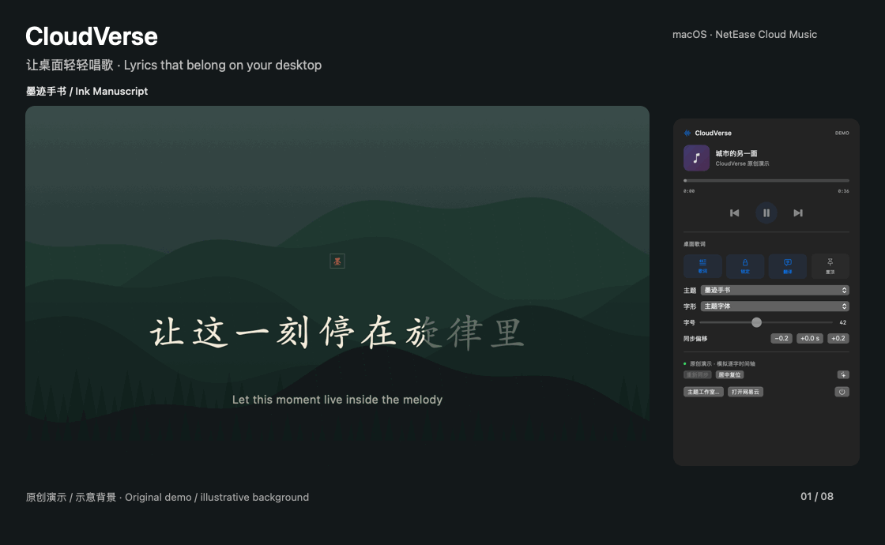
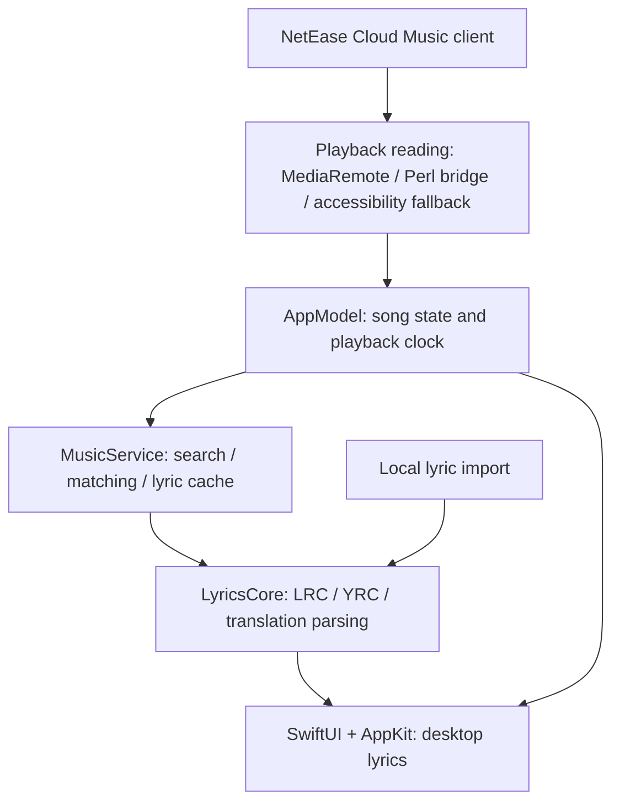

<!-- readme-skill:begin hero -->
# CloudVerse

Let your desktop sing softly. A third-party desktop lyrics app for the NetEase Cloud Music macOS client, with synchronized lyrics that blend into your wallpaper or stay on top.


[](LICENSE)

[中文](README.md) · English

[Quick Start](#quick-start) · [Author on GitHub](https://github.com/KieranGao)



*The GIF combines renders of the app's actual lyric components and control panel, showing eight wallpaper-blending themes. It uses local original demo lyrics, simulated word timing, and illustrative backgrounds—not a recording of live NetEase playback. The app also includes three classic themes.*
<!-- readme-skill:end hero -->

<!-- readme-skill:begin quick-start -->
## Quick Start

### Requirements

- macOS 13 or later; the currently verified environment is Apple Silicon.
- A compatible Swift 5.9 or later toolchain and macOS SDK, available through Xcode Command Line Tools; no third-party Swift packages are required.
- The NetEase Cloud Music macOS client for actual playback and synchronization; it is not needed for the local demo.
- Network access for searching and fetching lyrics; the default playback compatibility adapter uses the system `/usr/bin/perl` and a module bundled with the app.

### Build from Source

Run the following commands in a terminal:

```bash
git clone https://github.com/KieranGao/CloudVerse.git
cd CloudVerse
bash scripts/build-app.sh
open dist/CloudVerse.app
```

The script creates `dist/CloudVerse.app`, bundles the playback bridge and icons, and applies a local ad hoc signature. This is not Developer ID signing or Apple notarization; the current build workflow does not include notarization.

### Display Your First Lyric

1. Play a song in the NetEase Cloud Music client, then open CloudVerse.
2. Settings open on first launch. The defaults are Ink Manuscript, 42 pt, lower-center placement, and locked, click-through lyrics.
3. Once the song is recognized, lyrics follow its playback position. Left-click the menu bar waveform icon for the control panel, or right-click for the shortcut menu.
4. If the connection is unavailable, open “连接与权限” (Connection & Permissions) for its status. You can also select “开启演示模式” (Enable Demo Mode) to try local lyrics without network access or player control.

Accessibility permission is only used by the fallback reading path, not every connection method. Grant it through system settings from Connection & Permissions when needed; some NetEase client versions do not expose usable accessibility information.
<!-- readme-skill:end quick-start -->

<!-- readme-skill:begin features -->
## Features

- **Synchronized lyrics**: Line-based LRC display and word-by-word YRC highlighting. Plain LRC never receives invented word timing; translation display depends on existing translation data.
- **Wallpaper blending**: Eight wallpaper-blending themes plus the three classic themes Aurora, Ink, and Signal, with theme fonts, size, opacity, and previous/next-line options.
- **Position and layering**: By default, lyrics sit above the wallpaper and below ordinary app windows. Switch to always-on-top, unlock to drag, then lock again to restore click-through.
- **Menu bar controls**: Previous, play/pause, and next, alongside theme, font, translation, lyric visibility, and synchronization offset settings. Actual playback control requires an available playback bridge and the NetEase media source.
- **Lyric version management**: Automatic search and matching, manual song-version selection, local caching, and UTF-8 LRC/YRC/TXT import.
- **Independent demo**: Local original lyrics and simulated timing, with no network requests or NetEase control. Choose an illustrative background in the theme studio, or explicitly load a static thumbnail of your current wallpaper.
<!-- readme-skill:end features -->

<!-- readme-skill:begin usage -->
## Usage

### Customize the Desktop Appearance

Left-click the menu bar icon for the control panel, then select “主题工作室…” (Theme Studio) for full settings. Choose a theme, font, and layout under “外观与主题” (Appearance & Themes). Unlock the lyrics, drag the lyric area, and lock it again when done. If another app hides the lyrics, temporarily enable “置顶” (Always on Top).

### Adjust Timing and Song Versions

Under “歌词与同步” (Lyrics & Sync), adjust the offset: **positive values show lyrics earlier; negative values show them later**. If matching selects a cover or live version, search by song or artist and choose the correct version manually, or select “重新匹配” (Match Again).

A current song is required before importing local lyrics. Select a UTF-8 file through “导入 LRC / YRC” (Import LRC / YRC). LRC, YRC, and TXT are supported, with a 5 MiB limit; the imported lyrics apply to the current track.

### Common Settings

Preferences are stored in the system `UserDefaults` and restored after restart. These are the first-launch defaults; existing user settings may differ.

| Setting | Default | Purpose |
|---|---|---|
| Theme | Ink Manuscript | Choose the lyric appearance |
| Font size | 42 pt | Adjustable from 20–72 pt |
| Lyric width | 820 pt | Adjustable from 420–1400 pt |
| Opacity | 95% | Adjustable from 30%–100% |
| Display layer | Desktop | Can switch to always-on-top |
| Lock / click-through | Enabled | Unlock to drag lyrics |
| Translation | Enabled | Show available translations |
| Sync offset | 0 seconds | Adjustable from −10 to +10 seconds |

The settings sidebar displays the author, **KieranGao**, at the bottom. Select “访问 GitHub” (Visit GitHub) to open the author's personal profile directly.
<!-- readme-skill:end usage -->

<!-- readme-skill:begin workflow -->
## Workflow

Playback reading, lyric matching, and rendering are handled separately. Playback snapshots provide both song identity and the synchronization clock; local imports reuse the same parsing and display components.



The default reading path tries MediaRemote directly. When restricted, it can load the bundled playback module in an independent Perl subprocess or try accessibility fallback. The compatibility adapter can be disabled under Connection & Permissions.
<!-- readme-skill:end workflow -->

<!-- readme-skill:begin compatibility -->
## Compatibility and Privacy

CloudVerse is an independent third-party project, not an official NetEase Cloud Music product. It does not modify NetEase files, inject code into NetEase, or read account information or cookies.

| Situation | Details and Suggested Action |
|---|---|
| Playback information is unavailable | MediaRemote and the compatibility bridge use non-public, unstable interfaces that may stop working after system updates. Check Connection & Permissions, detect again, or try accessibility fallback. |
| A browser takes over the media source | Click play in the NetEase client, then synchronize again. Controls verify the source and read back state, but a race remains if the system media source switches at that instant. |
| Lyrics are missing or the version is wrong | Unofficial lyric endpoints may change, rate-limit requests, or return only plain LRC. Select a song version manually or import local lyrics; YRC and translations are not guaranteed for every song. |
| Desktop lyrics are covered | Full-screen apps, Stage Manager, or third-party desktop tools can affect layering. Try always-on-top; these combinations have not all been verified. |
| Wallpaper preview differs from the desktop | The preview is a statically cropped thumbnail. It does not change the system wallpaper or request screen recording; dynamic wallpapers or protected files may not preview accurately. |
| Intel or App Store distribution | The currently verified environment is Apple Silicon; Intel has not been verified. Non-public playback interfaces are unsuitable for Mac App Store sandboxed distribution. |

Online search sends the current song title, artist, or manual query to `music.163.com` and caches lyrics for local display. Demo mode uses local data; normal online matching is not a fully offline feature.
<!-- readme-skill:end compatibility -->

<!-- readme-skill:begin development -->
## Development and Verification

Run the following commands from the repository root.

```bash
swift run CoreChecks
```

`CoreChecks` is an executable behavior check that does not depend on XCTest. It covers lyric parsing, caching, playback time, song matching, display safety, and theme configuration.

After packaging, run offline UI checks and export previews:

```bash
dist/CloudVerse.app/Contents/MacOS/CloudVerse --smoke-test
dist/CloudVerse.app/Contents/MacOS/CloudVerse --check-visual
dist/CloudVerse.app/Contents/MacOS/CloudVerse --render-themes
```

Previews are written to `dist/ThemePreviews/`. These checks do not establish successful live playback on every system and NetEase client version.

| Path | Responsibility |
|---|---|
| `Sources/CloudVerse/` | Menu bar, settings, playback reading, and desktop lyric UI |
| `Sources/LyricsCore/` | Lyric parsing, song matching, caching, and time models |
| `Sources/PlaybackBridge/` | Independent playback reading and control bridge |
| `Tests/LyricsCoreTests/` | Core behavior checks |
| `Resources/` | App Info and icon assets |
| `scripts/build-app.sh` | Release building, packaging, and ad hoc signing |

Report issues or suggest improvements through [GitHub Issues](https://github.com/KieranGao/CloudVerse/issues).
<!-- readme-skill:end development -->

<!-- readme-skill:begin maintainer -->
## Author and License

Developed by [KieranGao](https://github.com/KieranGao). The app's `Info.plist` includes author attribution and the personal profile URL, with a direct-access button in the settings sidebar.

This project is licensed under the [MIT License](LICENSE).
<!-- readme-skill:end maintainer -->
