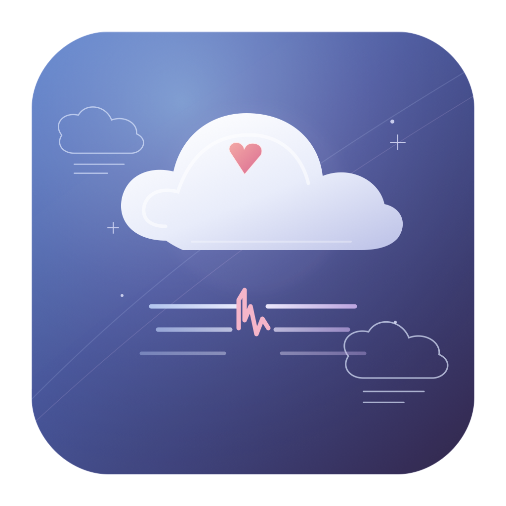
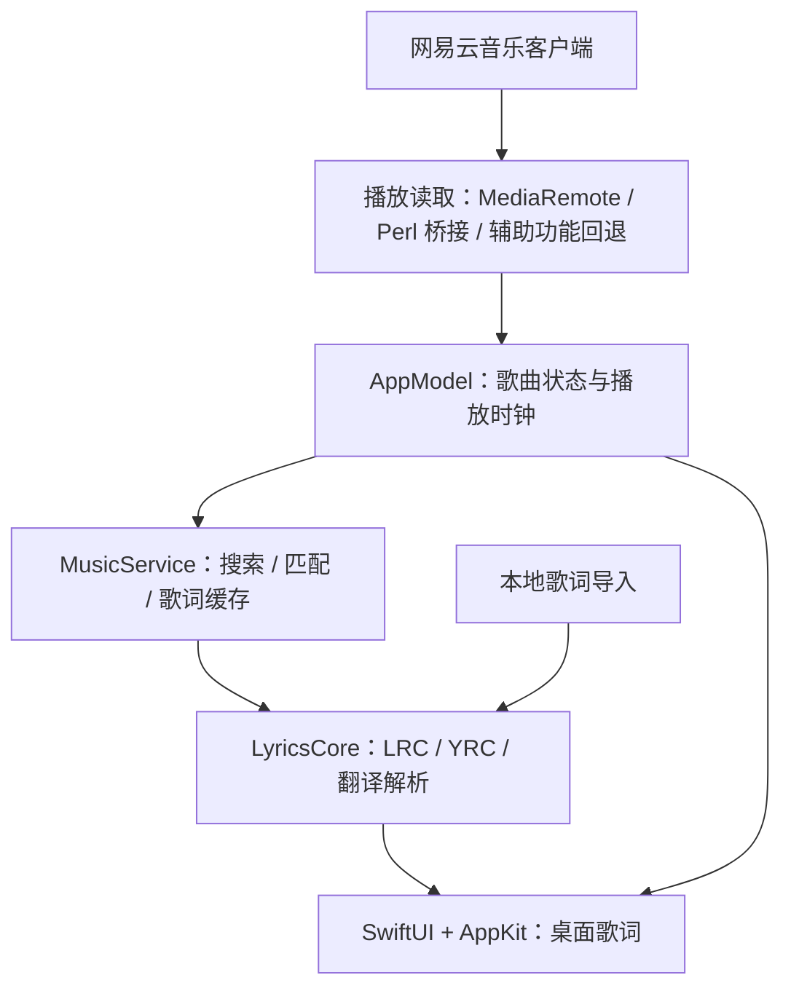

<!-- readme-skill:begin hero -->
<div align="center">
  <a href="#快速开始"></a>

  <h1>CloudVerse</h1>

  <p>让桌面轻轻唱歌。为网易云音乐 macOS 客户端打造的第三方桌面歌词应用，<br>让同步歌词融入壁纸，也能置歌词于顶端。</p>

  <p>
    
    
    <a href="LICENSE"></a>
  </p>

  <p>中文 · <a href="README-en.md">English</a>　·　<a href="#快速开始">快速开始</a></p>
</div>

<div align="center">
  
</div>

<div align="center"><sub>由用户提供的真实录屏截取并转换，展示极光壁纸上的歌词换句与逐字高亮；已裁去顶部菜单栏。GIF 为无声循环，未改变片段播放速度。</sub></div>
<!-- readme-skill:end hero -->

<!-- readme-skill:begin quick-start -->
## 快速开始

### 环境要求

- macOS 13 或更高版本；当前验证环境为 Apple Silicon。
- Swift 5.9 或更高版本的兼容工具链与 macOS SDK，可通过 Xcode Command Line Tools 提供；无需安装第三方 Swift 包。
- 网易云音乐 macOS 客户端，用于实际播放与同步；仅体验本地演示时不需要。
- 联网搜索和获取歌词需要网络；默认播放兼容适配使用系统 `/usr/bin/perl` 与随应用打包的模块。

### 从源码构建

在终端中运行以下命令：

```bash
git clone https://github.com/KieranGao/CloudVerse.git
cd CloudVerse
bash scripts/build-app.sh
open dist/CloudVerse.app
```

脚本会生成 `dist/CloudVerse.app`、打包播放桥接模块和图标，并执行本地临时签名。此签名不等于 Developer ID 签名或 Apple 公证；当前构建流程不包含公证步骤。

### 显示第一句歌词

1. 在网易云音乐客户端播放一首歌曲，再打开 CloudVerse。
2. 首次启动会打开设置窗口；默认使用「墨迹手书」、42 pt、下方居中，歌词锁定且鼠标穿透。
3. 自动识别歌曲后，歌词会随播放位置显示。左击菜单栏波形图标打开控制面板，右击打开快捷菜单。
4. 若连接不可用，进入「连接与权限」查看具体状态；也可以点击「开启演示模式」先体验本地歌词，无需联网或控制播放器。

辅助功能授权仅供读取回退路径使用，并非所有连接方式都需要。需要时可从「连接与权限」进入系统设置授权；部分网易云客户端不提供可用的辅助功能信息。
<!-- readme-skill:end quick-start -->

<!-- readme-skill:begin features -->
## 功能特性

- **同步歌词**：支持 LRC 逐行显示和 YRC 逐字高亮；普通 LRC 不伪造逐字时间，翻译显示依赖已有翻译数据。
- **桌面融合**：八款壁纸融合主题与 Aurora、Ink、Signal 三款经典主题，支持主题字体、字号、透明度和上下句显示。
- **位置与层级**：默认位于壁纸之上、普通应用窗口之下；可切换置顶，解锁拖动后重新锁定并恢复鼠标穿透。
- **菜单栏控制**：集成上一首、播放／暂停、下一首，以及主题、字体、翻译、歌词显隐和同步偏移设置；实际控制需要可用的播放桥接与网易云媒体源。
- **歌词版本管理**：自动搜索匹配、手动确认歌曲版本、本地缓存，以及 UTF-8 LRC／YRC／TXT 导入。
- **独立演示**：本地原创歌词和模拟时间轴，不请求网络、不控制网易云；可在主题工作室选择示意背景，或主动读取当前壁纸的静态缩略图。
<!-- readme-skill:end features -->

<!-- readme-skill:begin usage -->
## 使用方法

### 调整桌面效果

左击菜单栏图标打开控制面板，点击「主题工作室…」进入完整设置。在「外观与主题」中选择主题、字形与排版；解锁后拖动歌词区域，完成后重新锁定。若歌词被其他应用遮挡，可临时开启「置顶」。

### 校准歌词与歌曲版本

在「歌词与同步」中调整同步偏移：**正值使歌词提前显示，负值使歌词延后显示**。若匹配到翻唱或现场版，搜索歌名或歌手并手动选择正确版本，也可点击「重新匹配」。

导入本地歌词前需要已有当前歌曲。通过「导入 LRC / YRC」选择 UTF-8 文件，支持 LRC、YRC、TXT，文件上限为 5 MiB；导入歌词用于当前曲目。

### 常用设置

偏好保存在系统 `UserDefaults` 中，重启后会恢复。以下为首次启动的默认值；已有用户设置可能不同。

| 设置 | 默认值 | 用途 |
|---|---|---|
| 主题 | 墨迹手书 | 选择歌词视觉风格 |
| 字号 | 42 pt | 可调范围 20–72 pt |
| 歌词宽度 | 820 pt | 可调范围 420–1400 pt |
| 透明度 | 95% | 可调范围 30%–100% |
| 显示层级 | 桌面 | 可切换置顶 |
| 锁定／鼠标穿透 | 开启 | 解锁后可拖动歌词 |
| 翻译 | 开启 | 显示已提供的翻译 |
| 同步偏移 | 0 秒 | 可调范围 −10 至 +10 秒 |
<!-- readme-skill:end usage -->

<!-- readme-skill:begin workflow -->
## 工作流程

播放读取、歌词匹配和歌词绘制分别处理；播放快照同时提供歌曲身份与同步时钟，本地导入也复用相同的歌词解析与显示组件。



默认读取路径会尝试直接 MediaRemote；受限时可使用独立 Perl 子进程加载随包播放模块，或尝试辅助功能回退。兼容适配可以在「连接与权限」中关闭。
<!-- readme-skill:end workflow -->

<!-- readme-skill:begin compatibility -->
## 兼容性与隐私

CloudVerse 是独立第三方项目，不代表网易云音乐官方。应用不修改网易云文件、不向网易云注入代码，也不读取账号或 Cookie。

| 情况 | 说明与处理 |
|---|---|
| 播放信息无法读取 | MediaRemote 和兼容桥接使用非公开稳定接口，可能随系统更新失效；查看「连接与权限」，尝试重新检测或辅助功能回退。 |
| 浏览器抢占媒体源 | 回网易云客户端点击播放，再重新同步。控制会核验来源并回读状态，但系统媒体源瞬间切换仍存在竞态风险。 |
| 歌词缺失或版本错误 | 非官方歌词接口可能变更、限流或只返回普通 LRC；可手动选曲或导入本地歌词，不能保证每首歌都有 YRC 或翻译。 |
| 桌面歌词被遮挡 | 全屏应用、Stage Manager 或第三方桌面工具可能影响覆盖关系；可尝试置顶，相关组合未逐一验证。 |
| 壁纸预览与桌面不同 | 当前壁纸预览为静态裁切缩略图，不修改系统壁纸、不请求屏幕录制；动态壁纸或受保护文件可能无法准确预览。 |
| Intel 或 App Store 分发 | 当前验证环境为 Apple Silicon，未验证 Intel；非公开播放接口不适用于 Mac App Store 沙盒分发。 |

联网搜索会将当前歌名、歌手或手动查询发送到 `music.163.com`，并缓存歌词用于本地显示。演示模式使用本地数据；正常联网匹配并非完全离线功能。
<!-- readme-skill:end compatibility -->

<!-- readme-skill:begin development -->
## 开发与验证

以下命令均在仓库根目录执行。

```bash
swift run CoreChecks
```

`CoreChecks` 是不依赖 XCTest 的可执行行为检查，覆盖歌词解析、缓存、播放时间、歌曲匹配、显示安全与主题配置。

打包后可执行离线界面检查与预览导出：

```bash
dist/CloudVerse.app/Contents/MacOS/CloudVerse --smoke-test
dist/CloudVerse.app/Contents/MacOS/CloudVerse --check-visual
dist/CloudVerse.app/Contents/MacOS/CloudVerse --render-themes
```

预览输出至 `dist/ThemePreviews/`。上述检查不等于在所有系统与网易云客户端版本上通过真实播放验收。

| 路径 | 职责 |
|---|---|
| `Sources/CloudVerse/` | 菜单栏、设置、播放读取与桌面歌词界面 |
| `Sources/LyricsCore/` | 歌词解析、歌曲匹配、缓存与时间模型 |
| `Sources/PlaybackBridge/` | 独立播放读取与控制桥接模块 |
| `Tests/LyricsCoreTests/` | 核心行为检查 |
| `Resources/` | 应用 Info 与图标素材 |
| `scripts/build-app.sh` | Release 构建、打包与临时签名 |

反馈问题或提出改进建议，请使用 [GitHub Issues](https://github.com/KieranGao/CloudVerse/issues)。
<!-- readme-skill:end development -->

<!-- readme-skill:begin maintainer -->
## 许可证

本项目采用 [MIT 许可证](LICENSE)。
<!-- readme-skill:end maintainer -->
